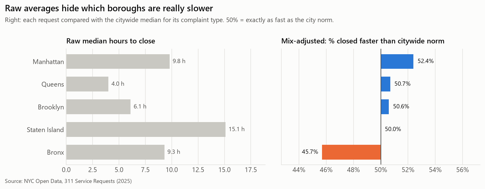
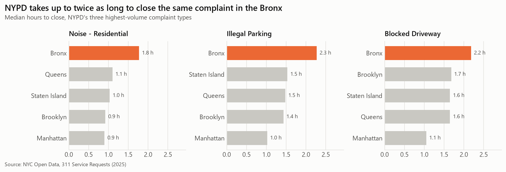
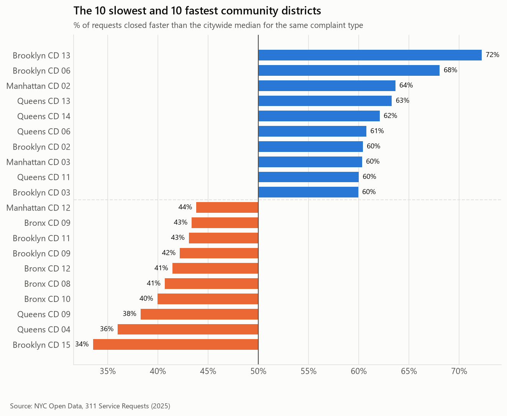
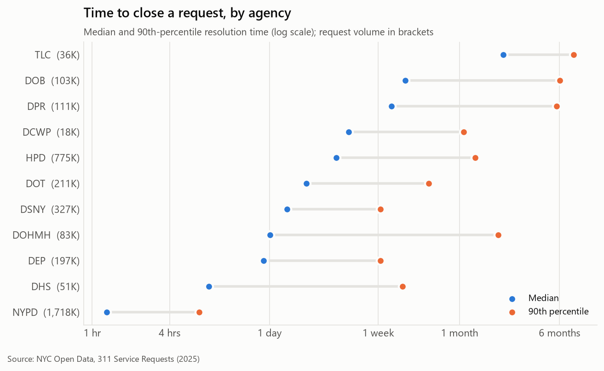
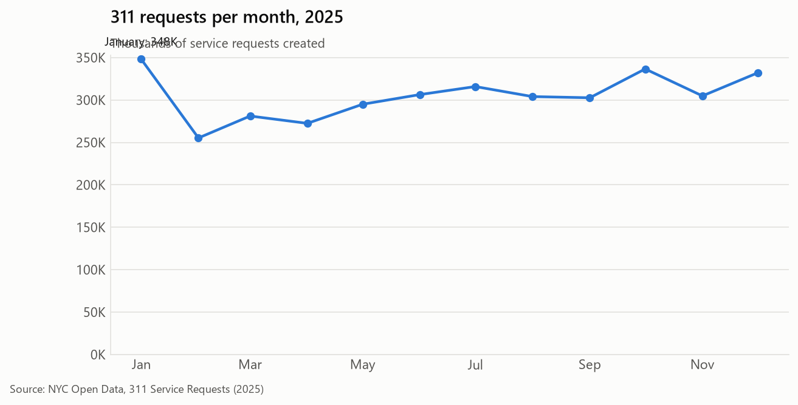
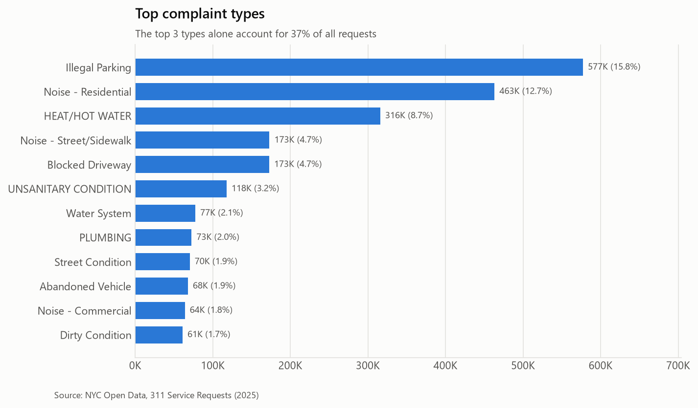
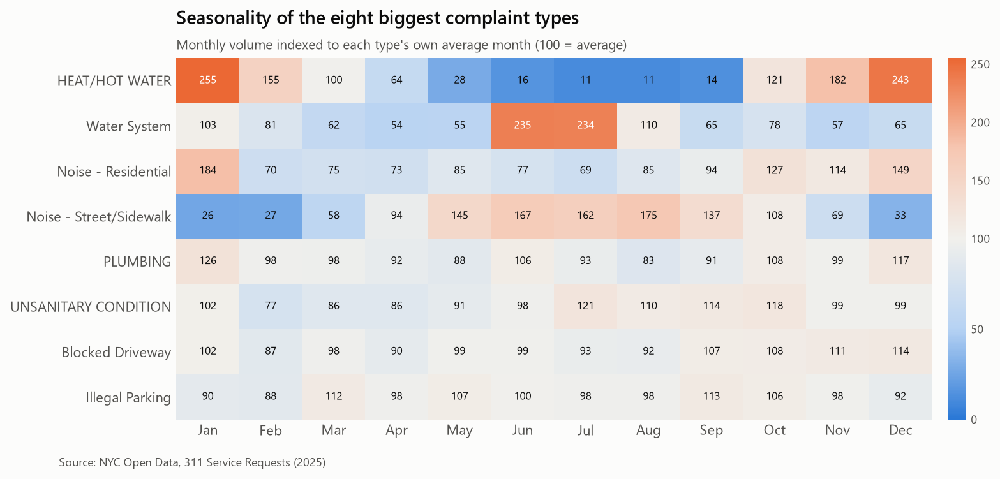
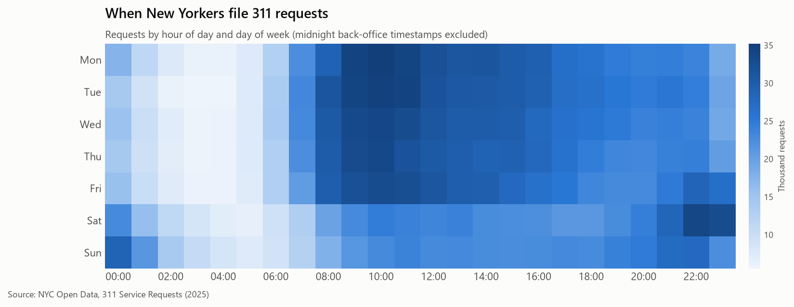

# NYC 311 Service Performance Analysis (2025)

**Do some New York neighborhoods get slower city service for the same problem?**
An end-to-end analysis of **3.66 million** real 311 service requests from NYC Open Data,
covering extraction, SQL cleaning, data-quality audit, performance analysis, and a
complaint-mix-adjusted equity comparison, with recommendations for city operations teams.

**Tools:** Python (pandas, matplotlib) · SQL (DuckDB) · REST API extraction · Jupyter

---

## Executive summary

| # | Finding | Evidence |
|---|---|---|
| 1 | **Three complaint types drive 37% of all demand**: illegal parking, residential noise, heat/hot water | 1.36M of 3.66M requests |
| 2 | **HPD (housing) is the bottleneck.** 775K requests, median 3.3 days, **p90 of 40 days**; only 65% closed within a week | [agency chart](images/05_agency_resolution.png) |
| 3 | **Raw averages point to the wrong borough.** Staten Island has the slowest raw median (15.1 h) but is exactly at the city norm once complaint mix is controlled | [borough chart](images/06_borough_equity.png) |
| 4 | **The Bronx is the only borough behind after mix adjustment** (45.7% of requests beat the citywide benchmark vs 50–52% elsewhere), and **the entire gap is NYPD** | Without NYPD the Bronx scores 51.7% |
| 5 | **NYPD takes up to ~2× longer to close the same complaint in the Bronx.** Residential noise: 1.8 h vs 0.9 h in Brooklyn/Manhattan. The Bronx files 45% of the city's noise complaints with ~17% of its population | [NYPD chart](images/08_nypd_core_types.png) |
| 6 | **District spread is much wider than borough spread.** Brooklyn CD 15 (34%) vs neighboring Brooklyn CD 13 (72%). CD 15 illegal-parking complaints take 7.1 h vs a 1.5 h city norm | [district chart](images/07_district_ranking.png) |
| 7 | **Demand is highly seasonal and predictable.** Heat complaints swing ~23× between January and July; water-system complaints double in June–July | [seasonality chart](images/03_seasonality.png) |

### Recommendations
1. **Audit NYPD 311 response capacity** in the Bronx, Brooklyn CD 15 and Queens CD 4/9, focused on Friday and Saturday 10 pm to 1 am, when noise complaints peak.
2. **Add a 30-day escalation SLA for HPD**: the long tail (p90 of 64–77 days for leaks, door/window and unsanitary conditions) is what residents feel.
3. **Staff to the seasonal curve**: heat (Nov–Feb) and water-system (Jun–Jul) peaks are predictable months ahead.
4. **Fix upstream data issues** (DOT timestamps, EDC bulk closures) before building agency KPIs on this feed.
5. **Report mix-adjusted metrics**, not raw borough medians.

---

## Key visuals









<details>
<summary>More charts: demand patterns</summary>






</details>

---

## Methodology

### Complaint-mix-adjusted benchmark
Boroughs file very different mixes of complaints, so comparing raw resolution times
compares apples to oranges. Instead:

1. For each complaint type with ≥500 closed requests (112 types), compute the **citywide median** resolution time.
2. Score every request **1** if it closed faster than its type's citywide median, **0** if slower, **0.5** on a tie.
3. Average the scores by area. Citywide this is 50% by construction; **below 50% = slower than the city norm for that area's mix.**

This is a form of indirect standardization. Unlike an average-hours comparison, it is robust
to the extreme right skew in resolution times (NYPD closes in hours, DOB in months).

**Sensitivity checks** (`borough_equity_robustness`): the Bronx result holds when zero-duration
auto-closures are removed (45.0%) and disappears when NYPD is removed (51.7%). That is how
the gap was traced to a single agency.

### Data quality audit
Every issue is flagged in the staging table rather than silently deleted, and its impact is measured:

| Issue | Rows | Handling |
|---|---|---|
| Closed before created | 916 (91% from DOT) | Excluded |
| Zero-duration closures | 64.8K (30% of DOHMH requests) | Kept (legitimate auto-closures); sensitivity-tested |
| Still open at extract | 55.7K | Excluded from resolution times only |
| Same complaint type spelled two ways (`Plumbing` / `PLUMBING`) | 2 types | Mapped to the most common spelling |
| Invalid community board | 42.7K | Excluded from district analysis only |
| EDC helicopter complaints bulk-closed after a median of 327 days | 20.6K | EDC excluded from agency comparisons |

### Limitations
- "Closed" is an administrative status, not proof the problem was fixed.
- Mix adjustment controls for complaint type, not for severity within a type or repeat callers.
- Volume is not normalized per resident at district level. The load explanation for NYPD is a hypothesis to test, not a proven cause.

---

## Project structure

```
nyc-311-service-analysis/
├── src/
│   ├── extract.py          # Paginated Socrata API extract → monthly Parquet files
│   ├── queries.py          # Loads named SQL queries and runs them in DuckDB
│   ├── charts.py           # Chart functions (consistent style, colorblind-safe palette)
│   └── run_analysis.py     # Runs every query → outputs/*.csv and images/*.png
├── sql/
│   ├── 01_staging.sql      # Typing, cleaning, normalization, data-quality flags
│   ├── 02_data_quality.sql # Data-quality audit
│   ├── 03_demand.sql       # Volume, seasonality, time-of-day, channel mix
│   ├── 04_performance.sql  # Resolution time by agency and complaint type, backlog
│   └── 05_equity.sql       # Mix-adjusted borough and district benchmark, drill-downs
├── notebooks/
│   └── nyc311_analysis.ipynb  # Full narrative analysis
├── outputs/                # Every query result as CSV
└── images/                 # Charts
```

SQL techniques used: CTEs, window functions (running totals, `PARTITION BY` shares,
seasonal indexing), `MEDIAN` / `quantile_cont` percentiles, `FILTER` clauses, regex
validation, and conditional aggregation.

## Reproduce

```bash
python -m venv .venv
.venv\Scripts\activate            # macOS/Linux: source .venv/bin/activate
pip install -r requirements.txt

python src/extract.py --year 2025     # ~10 min, ~150 MB of Parquet in data/raw/
python src/run_analysis.py --rebuild  # builds data/nyc311.duckdb, writes outputs/ and images/
jupyter lab notebooks/nyc311_analysis.ipynb
```

**Data source:** [NYC Open Data, 311 Service Requests from 2010 to Present](https://data.cityofnewyork.us/Social-Services/311-Service-Requests-from-2010-to-Present/erm2-nwe9) (extracted September 2026).
